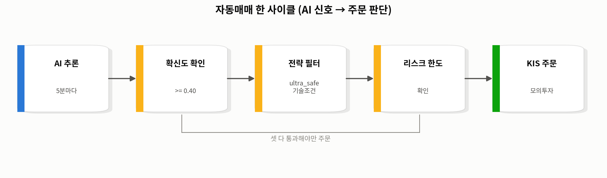
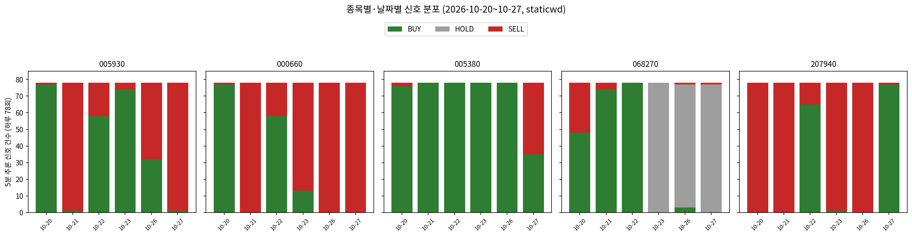
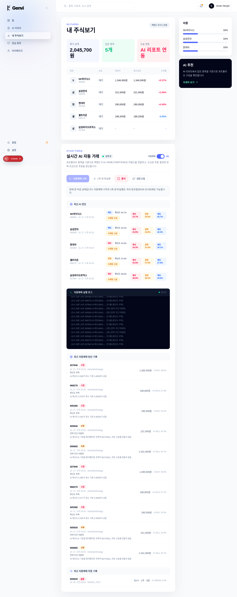
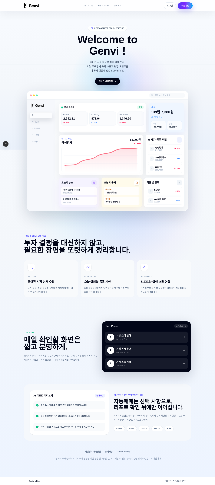

# 프로젝트 개요 (발표용 자료, 2026-10-27 기준)

이 문서는 README의 구조 설명에 실제 운영·실험 데이터를 더해, 프로젝트를 처음 보는 사람에게
"무엇을 왜 이렇게 만들었고, 실제로 뭘 확인했는가"를 설명하기 위해 정리했다. 구현 세부사항(API
경로, 테이블명 등)보다 설계 의도와 데이터 해석을 중심으로 썼다. **운영 결과 수치는 현재 라이브
모델(`staticwd`, 2026-10-19 교체) 기준으로만 정리했다.** 모델을 어떻게 개선했는지 설명하는 절(5절)
에서만 교체 전 버전과의 비교 수치가 나온다.

## 1. 문제 정의

코스피 상위 종목에 대해 "다음 거래일 가격이 오를지/내릴지"를 예측하는 AI를 만들고, 그 예측이
실제로 주문까지 이어지는 자동매매 시스템을 끝까지(end-to-end) 구축해서 검증하는 것이 목표다.
"AI가 잘 맞춘다"는 주장만으로는 부족하다고 보고, 실제 장중 데이터로 (1) 예측 파이프라인이
끊기지 않고 도는지, (2) 예측이 백엔드·전략을 거쳐 실제 주문 판단까지 이어지는지, (3) 그 판단이
타당한지를 모의투자 계좌로 실측했다.

## 2. 전체 아키텍처와 프로그램 흐름

세 개의 레포(AI / 백엔드 / 프론트엔드)로 역할을 나눠, 각자 독립적으로 개발·반복할 수 있게 했다.

```
운영 데이터 수집 (코스피 350종목, 1분·5분·일봉·수급·매크로·공시)
      │
      ▼
AI 학습용 DB (200종목 — AI 커버 유니버스만 분리) ── 매일 16:45 피처 재계산
      │
      ▼
AI 추론 서버 (serving) ── 5분마다, 지정 종목 최신 입력으로 매수/관망/매도 확률 계산
      │   POST /ai/realtime (예측 결과 전달)
      ▼
백엔드 (FastAPI) ── 예측 저장 + 자동매매 루프
      │   1) 확신도 확인 → 2) 전략(기술조건) 필터 → 3) 리스크 한도 확인 → 4) 주문
      │
      ├──▶ 프론트엔드 (종목 탐색, 자동매매 바구니, 포트폴리오 조회)
      └──▶ 한국투자증권 모의투자 API (잔고 조회 · 주문 · 체결 조회)
```

AI 서버와 백엔드는 완전히 분리된 프로세스라서, 모델을 바꾸거나 재학습해도 백엔드·프론트를 건드리지
않고 체크포인트 파일만 교체하면 된다(5절에서 실제로 이렇게 교체했다). 자동매매 판단은 "AI 신호"와
"전략 신호"가 **둘 다** 같은 방향을 가리켜야만 실행되게 했다 — AI 하나만 믿고 매매하지 않도록
의도적으로 이중 확인 구조를 넣은 것이다.



## 3. 기술 스택

| 영역 | 구성 |
|---|---|
| AI/모델 | PyTorch 기반 TFT(Temporal Fusion Transformer), 오픈소스 구현 기반 |
| AI 서빙 | FastAPI 추론 서버, PostgreSQL, 5분 주기 스케줄링 |
| 백엔드 | FastAPI, PostgreSQL, JWT 인증, 실시간 시세 구독 |
| 외부 연동 | 한국투자증권 Open API(모의투자), Google Gemini API(종목 리포트 생성) |
| 프론트엔드 | Next.js(React), 시세 차트 |
| 운영 | Linux cron 스케줄링, 워치독 스크립트(프로세스 다운 감지·재기동) |

프론트엔드는 종목 탐색·자동매매 바구니 구성·포트폴리오 조회 화면을 백엔드 REST API로만 통신하는
얇은 클라이언트로 두고, 판단·주문 로직은 전부 백엔드에 뒀다.

## 4. 모델 세부사항

### 4.1 TFT 구조 자체는 바꾸지 않았다

핵심 아키텍처(인코더, 어텐션, 변수 선택 게이트, static/historical/future 3종 입력 구조)는 오픈소스
라이브러리(`tft-torch`, PlaytikaOSS 공개 구현)를 그대로 가져다 썼다. 거기에 더한 건 두 가지뿐이다:

- **분류 출력 헤드 추가**: 원래 TFT는 수치(분위수) 예측용이라, 매수/관망/매도 3-클래스 분류에
  쓰기 위해 출력 헤드 하나를 새로 달았다. 이걸 빼면 나머지 구조는 라이브러리 그대로다.
- **정적 임베딩 전용 dropout**(실험만, 최종 미채택): 정적 특성 과의존 완화 실험 중 하나로
  구조에 넣어봤지만 성능이 더 나빠서(4.3절) 쓰지 않았다.

**지금 라이브에 실제로 쓰이는 수정(`static_weight_decay`)은 아키텍처 변경이 아니다.** 모델
구조는 그대로 두고, 학습 설정(정적 임베딩에만 추가 적용한 weight decay, 과적합 억제 기법)만
조정한 것이다.

### 4.2 입력 피처 (분류별)

TFT는 입력을 세 종류로 나눠 받는 구조다. 이 프로젝트는 세 종류를 다음과 같이 채웠다.

| 입력 종류 | 포함 피처(그룹) |
|---|---|
| 정적(종목 고유, 안 변함) | 업종(`sector_id`), 시장구분(코스피/코스닥, `market_id`) |
| 시계열(과거 60거래일치) | **가격·모멘텀**(수익률, 이격도 3종, RSI, 변동성) · **업종 상대지표**(업종수익률 3종, 업종이동평균비율, 업종변동성, 업종거래비율) · **기업 이벤트**(유상증자·무상증자·배당·액면분할 플래그) · **레버리지/리밸런싱 수급**(레버리지 운용자산, 자산/시총비율, 예상 리밸런싱 플로우) · **변동성완화장치(VI) 발동 이력** · **해외/매크로**(코스피·코스닥·S&P500·나스닥·필라델피아반도체지수 수익률, VIX·원달러환율·미국10년물금리·한미금리차·WTI·금 변동) · 요일 |
| 미래 알려진 입력(캘린더 기반, 미리 알 수 있음) | 한국은행 금리결정일·FOMC·국내/미국 쿼드러플위칭일 플래그, 시간 진행도 |

시계열 33개 + 정적 2개 + 미래알림 5개. "오늘 이 종목에 무슨 일이 있었나"(시계열), "이 종목이
원래 어떤 종목인가"(정적), "오늘이 어떤 날인가"(미래알림)를 구조적으로 분리해서 넣는 게 TFT를
선택한 이유였는데, 이 분리 구조 자체가 역설적으로 과의존 문제를 만들기도 했다(4.3절).

### 4.3 학습·검증 기간

| 구분 | 기간 | 용도 |
|---|---|---|
| 학습(train) | 2019-01-02 ~ 2023-12-31 (5년) | 모델 파라미터 학습 |
| 검증(val_2024) | 2024-01-01 ~ 2024-12-31 | 체크포인트/하이퍼파라미터 선택 기준(timing IC) |
| 테스트(2025) | 2025년 전체 | **한 번도 채점하지 않음** — 완전한 held-out, 모델 선택에 쓰지 않음 |
| 미래구간(OOT, 2026) | 2026년(라이브 운영 구간) | 선정된 체크포인트를 딱 한 번 채점해 확인(선택 근거로 쓰지 않음) |

2025년을 선택 과정에서 전혀 보지 않은 건, 모델을 고르는 동안 미래 데이터를 한 번도 들여다보지
않았다는 걸 보장하기 위한 의도적 설계다.

## 5. 모델을 어떻게 개선했는가 (성능 향상 과정)

### 5.1 라벨 정의부터 다시 잡은 것 — 가장 큰 성능 개선

처음엔 "내일 수익률이 플러스/마이너스"를 고정 임계값으로 매수/관망/매도로 나누려 했다. 그런데
하루 단위 개별 종목 수익률은 노이즈가 커서, 어떤 날은 전 종목이 관망, 어떤 날은 전 종목이 매수로
쏠리는 문제가 있었다. **라벨을 "그날 거래된 종목들 사이에서 상대적으로 수익률이 높은 30%는
매수, 낮은 30%는 매도"로 다시 정의**(cross-sectional quantile label)하자, 같은 모델 구조에서
검증 성능(timing IC, 아래에서 설명)이 **+0.0481 → +0.0732**로 뚜렷하게 좋아졌다. "오늘 수익률이
양수인가"보다 "이 종목이 오늘 다른 종목들보다 나은가"를 묻는 쪽이 모델이 배우기 쉬운 문제였다는
뜻이다.

*timing IC란*: 모델 점수(매수확률 − 매도확률)에서 "그 종목이 평소에 받는 평균 점수"를 뺀 나머지가
다음날 실제 수익률 순위와 얼마나 일치하는지를 재는 지표(상관계수, −1~+1)다. 종목 고유의 특성이
아니라 "오늘 뭔가 달랐는가"를 얼마나 잘 잡아내는지를 보려는 지표라서 핵심 성과 지표로 썼다.

### 5.2 라이브 전 교정 — 서빙 버그 수정 (evtfix, 2026-10-05)

라벨을 확정한 뒤 라이브에 올리기 직전, train/serve parity 점검에서 버그를 발견했다: 한국은행
금리결정일·FOMC·쿼드러플위칭 같은 이벤트 플래그 컬럼이 학습 때는 직전값이 유지(ffill)되는데,
실제 서빙 코드는 당일 값을 0으로 비워서 넘기고 있었다. 모델이 학습 때 한 번도 보지 못한 입력
패턴을 실시간으로 받고 있었던 것. 발견 즉시 고쳐서 재학습한 체크포인트로 교체하고 라이브를
시작했다(10/6).

### 5.3 라이브 중 발견한 문제 — 특정 종목의 "얼어붙은" 출력 (staticwd, 2026-10-19)

라이브 운영 중 5개 추론 종목 중 **삼성바이오로직스·셀트리온 두 종목의 예측 확률이 입력이 크게
바뀌어도 거의 그대로**인 현상이 관찰됐다(매수확률 표준편차 0.0055). 원인을 진단해보니, TFT가
시계열 정보와 종목의 정적 특성을 구조적으로 분리해서 받는 설계가 역설적으로 문제였다 — 모델이
"오늘 무슨 일이 있었나"보다 "이 종목이 원래 어떤 종목인가"에 과하게 의존하고 있었다. 세 가지
해법(정적 임베딩 드롭아웃, 정적 임베딩 전용 weight decay, 사후 보정)을 비교한 뒤 **정적 특성
경로에만 별도의 weight decay를 추가**하는 방법을 채택했다(동적 경로는 그대로 둠, 4.1절 참고).

| 지표 | 교체 전(evtfix) | 교체 후(staticwd, 현재 라이브) |
|---|---|---|
| 검증(val) timing IC | 0.0723 | 0.0729 (오차범위 내 유지) |
| 미래구간(OOT) timing IC | 0.0293 | 0.0296 |
| 삼성바이오로직스 반응성(rank_corr) | +0.464 | **+0.821** |

전체 성능은 거의 그대로 유지하면서, 문제가 됐던 종목의 반응성만 선택적으로 크게 개선했다. 10/19
밤 교체했고, 교체 직후 과거 22종목 재생 테스트로 라벨이 바뀐 건 1개뿐임을 확인한 뒤 6거래일
라이브 관찰로 재검증했다(6절).

## 6. 실제 운영 결과 (현재 모델 `staticwd`, 2026-10-20~10-27, 6거래일)

10/24(토)·10/25(일)은 휴장일이라 제외했다. 10/27(오늘)은 장 마감(15:30) 이후 집계한 전일치
데이터다.

### 6.1 파이프라인 안정성

**5분 주기 추론이 468/468회(78회 × 6일) 전부 정상 실행**됐고, 종목당 2,340건의 예측 중 백엔드
전송 실패·파이프라인 오류는 **0건**이다. "AI 추론 → 백엔드 전달" 구간은 완전히 안정적으로
동작했다. (10/20 하루는 전날 밤 모델 교체 작업 중, 10/27 오후는 이번 점검(로그 로테이션·정리)
작업 중 백엔드 프로세스가 재시작되며 자동매매 루프가 잠시 꺼져 있었던 별개의 운영 이슈였고,
추론 자체는 두 날 모두 영향 없었다.)

### 6.2 종목별·날짜별 신호 분포



종목마다 하루 단위로 신호가 통째로 쏠리는 패턴이 뚜렷하다 — 예를 들어 005930은 10/20엔 거의
전부 BUY였다가 10/21엔 거의 전부 SELL로 뒤집혔고, 000660도 같은 식으로 날짜마다 거의 한
방향으로 쏠린다. 반면 068270은 10/23~10/27 사이 BUY/SELL 신호가 거의 사라지고 HOLD로
수렴하는 구간이 보인다. 이런 날짜 단위의 쏠림은 개별 5분 추론이 노이즈로 흔들리는 게 아니라
그날의 전반적인 추세를 일관되게 따라가고 있다는 뜻으로 해석할 수 있다 — 다만 6.3절에서 보듯
이 신호들이 실제 체결로 이어지려면 확신도(0.40)와 전략 기술조건을 모두 통과해야 한다.

### 6.3 실제 체결은 6거래일 내내 0건 — 원인 분석

판단 기록은 1,575건 쌓였지만 실제 체결은 0건이다. 사유 집계:

| 사유 | 건수 |
|---|---|
| AI 확신도 부족(0.40 미달) | 1,055 |
| 전략 기술조건 미충족 | 505 |
| 매수 배분 없음 | 13 |
| 시세 없음 | 2 |

6거래일 동안 BUY 확신도가 0.40을 넘은 적은 한 번도 없었다(최고 0.3990, 10/23). SELL 확신도는
여러 날 0.40을 넘겼지만(최고 0.4636, 10/27) 보유 중인 포지션이 없어 전부 "관망" 처리됐다
(`ultra_safe`는 공매도를 하지 않고, 보유 수량이 0이면 매도 주문 자체를 만들지 않는다).

이 결과만 보면 "시스템이 안 되는 것 아니냐"고 오해할 수 있어서, 별도의 읽기 전용 시뮬레이션으로
원인을 데이터로 분리했다(운영 코드는 그대로 두고, 실제 5분봉과 실제 AI 예측을 재생). 이 시뮬레이션
은 교체 직전 모델(evtfix) 구간에서 처음 실행했는데, **전략 코드와 확신도 기준이 지금 모델에서도
그대로**라서 같은 논리가 적용된다:

| 시나리오 | 조건 | 체결 가능 건수(확신도 0.40 기준, 3일 누적) |
|---|---|---|
| 지금 운영 그대로 | AI 확신도 + 전략 기술조건(추세·RSI·볼린저) 둘 다 충족 | 0건 |
| 기술조건 없이 AI 신호만 | 확신도 기준만 확인 | 8건 |

확신도 기준을 낮춰도 체결은 거의 늘지 않지만(3일 합산 4건), 전략의 기술조건을 걷어내면 같은
확신도 기준에서 체결 기회가 8배로 늘어난다. **체결이 안 나는 주된 이유는 AI 확신도가 아니라
안전성을 위해 추가한 기술조건이 매우 보수적으로 설계되어 있기 때문**이다. staticwd로 교체한
뒤 6거래일 구간에서도 같은 양상(확신도 부족·기술조건 미충족이 판단 사유의 전부)이 재확인됐다.

**단, 이게 "기술조건을 없애는 게 더 낫다"는 뜻은 아니다.** 체결 가능 "횟수"만 센 것이고, 그
체결들이 실제로 수익이었는지는 검증하지 않았다. 이 프로젝트가 데이터로 입증한 것은 **"0건이
버그가 아니라 설계된 보수성의 결과"**라는 것과 **"안전성과 체결 빈도 사이에 뚜렷한 트레이드오프가
존재한다"**는 것이다.

### 6.4 원본 데이터 예시 (2026-10-27, 15:25 사이클)

주장만 하지 않고 실제로 쌓인 원본 레코드를 그대로 보여준다. 아래는 같은 사이클(15:25:02)에서
AI가 낸 예측과, 13초 뒤(15:25:13) 자동매매 루프가 그 예측으로 내린 판단이다.

**AI 예측 원본 (`ai_prediction_history`, 15:25:02)**

| 종목 | 신호 | 매수확률 | 관망확률 | 매도확률 | 모델 버전 |
|---|---|---|---|---|---|
| 005930 | SELL | 0.329 | 0.248 | 0.423 | v3_structure_nowd_cs-seed0-staticwd |
| 000660 | SELL | 0.337 | 0.206 | 0.457 | v3_structure_nowd_cs-seed0-staticwd |
| 005380 | BUY | 0.343 | 0.316 | 0.341 | v3_structure_nowd_cs-seed0-staticwd |
| 068270 | HOLD | 0.344 | 0.378 | 0.279 | v3_structure_nowd_cs-seed0-staticwd |
| 207940 | BUY | 0.380 | 0.282 | 0.338 | v3_structure_nowd_cs-seed0-staticwd |

**자동매매 판단 원본 (`auto_trade_decisions`, 15:25:13, 같은 사이클)**

| 종목 | 판단 | 사유 | AI 신호 | AI 확신도 | 당시 가격 |
|---|---|---|---|---|---|
| 207940 | SKIP | LOW_CONFIDENCE | BUY | 0.380 | 1,365,000원 |
| 068270 | SKIP | LOW_CONFIDENCE | HOLD | 0.378 | 188,600원 |
| 005380 | SKIP | LOW_CONFIDENCE | BUY | 0.343 | 290,500원 |
| 005930 | HOLD | STRATEGY_CONDITION_NOT_MET | SELL | 0.423 | 221,500원 |
| 000660 | HOLD | STRATEGY_CONDITION_NOT_MET | SELL | 0.457 | 1,341,000원 |

이 한 사이클만 봐도 6.3절의 패턴이 그대로 드러난다 — BUY 확신도(0.343~0.380)는 전부 0.40 미달로
SKIP, SELL 확신도(0.423~0.457)는 0.40을 넘었지만 전략 조건(보유 포지션 없음 포함) 때문에 HOLD.

### 6.5 실제 화면

**포트폴리오 / 자동매매 화면** (로그인 후, 실제 운영 데이터 기준) — 위 6.3·6.4절에서 표로 보여준
"최신 AI 판단"과 "최근 자동매매 판단 기록"이 실제 화면에 그대로 뜬다. 실시간 자동매매 실행
로그, 종목별 확신도, 판단 사유(확신도 부족/전략 조건 미충족)까지 화면에서 바로 확인할 수 있다.



종목명·현재가·등락률·평가금액까지 KIS 실시간 시세 기준으로 뜬다(이전엔 바구니에 저장된
닉네임을 그대로 보여주고 시세는 조회하지 않아 "-"만 떴던 버그를 이번에 고쳤다 —
`Front-Gentle-Viking` 커밋 `62a8962`).

**랜딩 페이지** — 서비스 소개 화면(참고용, 일부는 목업 데이터).



## 7. 이 프로젝트의 시사점·장점·차별점

- **백테스트에서 멈추지 않고 실제 장중 데이터로 끝까지(end-to-end) 돌렸다.** 추론 → 전달 →
  판단 → (모의)주문까지 실제 시세로 검증한 것이 핵심 차별점이다.
- **"모델이 잘 맞는다"에서 끝내지 않고, 라이브 모니터링 중 실제 문제를 발견 → 근본 원인 진단 →
  여러 해법 비교 → 데이터로 검증하는 피드백 루프를 두 번 실제로 돌렸다**(서빙 패리티 버그,
  정적 특성 과의존). 둘 다 모델 자체가 아니라 "모델과 서빙 환경의 불일치", "모델 구조의 편향"처럼
  숫자만 보고는 못 찾는 문제였다.
- **모델 선택 과정에서 미래 데이터(2025)를 한 번도 들여다보지 않는 엄격한 held-out 원칙을
  지켰다.** OOT(2026)도 선택 근거가 아니라 확인용으로만 1회 채점했다.
- **안전성을 설계에 녹였다**: 모의투자로 먼저 전체 경로를 검증, AI 신호와 전략 신호가 모두
  일치해야 주문이 나가는 이중 확인 구조, 종목당/1회 주문/전체 노출 한도.
- **"왜 체결이 0건인가"를 느낌이 아니라 시뮬레이션과 원본 데이터로 분리 증명**했다 — 확신도
  때문인지 전략 때문인지를 숫자로 나눠 보였고, 트레이드오프가 있다는 것까지는 보이되 "그래서
  어느 쪽이 낫다"는 과도한 결론은 내리지 않았다.
- **AI/백엔드/프론트를 독립된 레포·프로세스로 분리**해서, 모델을 재학습해도 체크포인트 파일만
  바꾸면 되는 구조로 만들었다 — 실제로 교체 두 번 모두 이 구조 덕분에 다른 컴포넌트를 건드리지
  않고 끝냈다.

## 8. 남은 과제 (한계)

- 체결 빈도와 수익성은 별개다. 체결가 기반 수익률 계산이 다음 단계로 남아있다.
- 정적 특성 과의존은 완화했지만 근본 원인(라벨이 여전히 종목 고유 특성에 끌리는 경향)은 남아있다.
  변동성 입력을 종목별로 정규화하는 다음 세대 레시피를 이미 찾아놨고(OOT timing IC +0.0332로
  지금까지 테스트한 모델 중 최고), 다음 재학습 사이클의 1순위 후보로 기록해뒀다.
- 두 가지 자금 배분 정책(`cap_cash` vs `redistribute`)의 실제 차이는 아직 비교 운영하지 않았다.
- 배포(실서비스화)는 이번 캡스톤 범위 밖으로 뺐다. 로컬 환경에서 전체 파이프라인이 끊기지 않고
  동작하는 것까지를 검증 범위로 잡았다.

## 9. 지금 고정되어 있는 추론 구성 (2026-10-27 기준 현재 상태)

발표에서 "지금 뭐가 돌고 있는가"를 한 문장으로 답해야 한다면 아래 표가 그 답이다.

| 항목 | 현재 값 |
|---|---|
| 모델 체크포인트 | `v3_structure_nowd_cs-seed0-staticwd` (2026-10-19 23시경 교체, 이후 미변경) |
| 추론 대상 종목 (5개, 고정) | 삼성전자(005930), SK하이닉스(000660), 현대차(005380), 셀트리온(068270), 삼성바이오로직스(207940) |
| 추론 주기 | 평일 09:00~15:30, 5분마다 |
| 라벨/출력 | 당일 종목 간 상대 순위 기반 매수(상위30%)/관망/매도(하위30%) 확률 |
| 자동매매 전략 | `ultra_safe` (1시간 상승추세 + 15분 RSI + 5분 볼린저밴드) |
| 최소 확신도 | 0.40 |
| 자금 배분 정책 | `cap_cash` (종목당 최대 30%, 나머지 현금 보유) |
| 거래 계좌 | 한국투자증권 모의투자 50215383-01 (`KIS_MOCK=true`, 실주문 아님) |
| 운영 상태 | 정상 가동 중 (자동매매 루프 RUNNING) |

이 조합은 10/19 밤 이후 바뀐 적이 없고, 지금 이 문서의 모든 운영 데이터(6절)는 이 고정된 조합
아래에서 나온 결과다.

## 10. 결론으로 쓸 수 있는 것

1. **"AI 추론 → 전달 → 자동매매 판단"까지 전 구간이 현재 모델 기준 6거래일, 468/468회 동안
   끊김 없이 동작함을 검증했다.**
2. **라이브 운영 중 발견한 두 가지 실제 문제(서빙 버그, 정적 특성 과의존)를 데이터로 진단하고
   해법을 비교해 고쳤고, 그 결과 문제 종목의 반응성이 +0.464 → +0.821로 개선됐다.**
3. **체결이 0건인 이유를 "버그"와 "설계된 보수성"으로 데이터와 원본 레코드로 분리해서 증명했고,
   안전성과 체결 빈도 사이의 트레이드오프를 정량화했다.** 어느 쪽이 더 나은지는 수익성 데이터가
   쌓여야 판단할 수 있다 — 그게 다음 단계다.

---
*근거 문서/코드: `AI_Gentle_Viking_RE/README.md`, `docs/model_swap_narrative_2026-10.md`,
`docs/inference_fill_report_2026-10-06_to_08.md`, `docs/inference_fill_report_2026-10-20_to_23.md`,
`AI_Gentle_Viking_RE/docs/model_versions.md`, `AI_Gentle_Viking_RE/training/config.py`
(미래알림 입력 정의), `AI_Gentle_Viking_RE/training/run_stage1_search.py`(학습/검증 기간),
`AI_Gentle_Viking_RE/training/train.py`(static_weight_decay 구현),
`AI_Gentle_Viking_RE/tft-torch`(로컬 포크 커밋 이력), `Front-Gentle-Viking/package.json`,
`Back-Gentle-Viking/requirements.txt`, `Back-Gentle-Viking/app/routes_trade.py`,
`Back-Gentle-Viking/backtest/strategies/ultra_safe.py`. 6절의 운영 수치와 원본 데이터 예시는
2026-10-27 작성 시점에 운영 DB(`ai_prediction_history`, `auto_trade_decisions`, `trade_logs`)를
직접 조회해 확인했다.*
