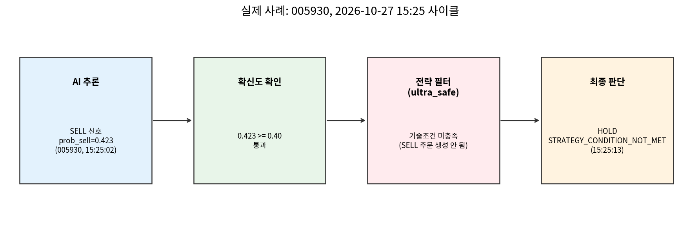

# 사례로 보는 자동매매 한 사이클 (2026-10-27 15:25)

발표용 "스토리형" 슬라이드 재료. `capstone_overview_for_presentation.md`의 숫자·주장을, 실제로
있었던 사이클 하나를 처음부터 끝까지 따라가며 보여주는 용도로 분리해서 정리했다. 메인 문서에는
넣지 않고 이 파일에서만 다룬다.

같은 시각(15:25) 5개 종목에 대해 AI가 예측을 내고, 13초 뒤 자동매매 루프가 그 예측으로 판단을
내렸다. 그중 서로 다른 결과로 끝난 두 종목을 골랐다 — 하나는 확신도 단계에서 걸러졌고, 하나는
확신도는 통과했지만 전략 단계에서 걸러졌다.

## 사례 1: 005930 — 확신도는 통과, 전략에서 걸러짐

1. **AI 추론 (15:25:02)**: 005930에 대해 SELL 신호, 매수확률 0.329 / 관망확률 0.248 /
   매도확률 **0.423**.
2. **확신도 확인**: 최소 기준 0.40을 0.423으로 통과 → 다음 단계로.
3. **전략 필터(`ultra_safe`)**: 1시간 상승추세 + 15분 RSI 과매수 + 5분 볼린저밴드 상단, 세
   조건이 동시에 안 맞아서(혹은 보유 포지션이 없어서) 매도 주문 자체가 생성되지 않음.
4. **최종 판단 (15:25:13)**: `HOLD`, 사유 `STRATEGY_CONDITION_NOT_MET`, 당시가 221,500원.

**포인트**: AI가 꽤 확신 있게(0.423) 매도 신호를 냈는데도 실제 주문으로 이어지지 않았다 —
확신도 하나만으로 움직이지 않는, 이중 확인 구조가 실제로 작동한 사례다.

## 사례 2: 207940 — 확신도 단계에서부터 걸러짐

1. **AI 추론 (15:25:02)**: 207940에 대해 BUY 신호, 매수확률 **0.380** / 관망확률 0.282 /
   매도확률 0.338.
2. **확신도 확인**: 최소 기준 0.40에 0.380으로 미달 → 전략 단계로 넘어가지 않고 바로 중단.
3. **최종 판단 (15:25:13)**: `SKIP`, 사유 `LOW_CONFIDENCE`, 당시가 1,365,000원.

**포인트**: BUY 확률이 관망·매도 확률보다 높긴 했지만(0.380 > 0.282, 0.338), 그것만으로는
"충분히 확신한다"고 보지 않는다 — 세 확률의 단순 최댓값이 아니라 0.40이라는 절대 기준을
넘어야 한다.

## 같은 사이클, 다른 결과 — 왜 이게 말이 되는가

두 사례 모두 AI는 신호를 냈지만 체결까지 가지 못했다. 그런데 걸러진 단계가 다르다 —
005930은 "확신도는 있는데 기술적 타이밍이 안 맞음", 207940은 "확신도 자체가 기준 미달".
이 차이가 왜 체결이 0건인지(메인 문서 6.3절)를 집계 숫자가 아니라 실제 사례로 보여준다:
확신도 부족과 전략 조건 미충족은 서로 다른 원인이고, 둘 다 "안전장치가 설계대로 작동한
결과"라는 같은 결론으로 이어진다.

---
*근거: 운영 DB(`ai_prediction_history`, `auto_trade_decisions`) 2026-10-27 15:25 사이클 원본
레코드. 메인 문서 `capstone_overview_for_presentation.md` 6.4절과 같은 사이클의 다른 종목
사례다.*
